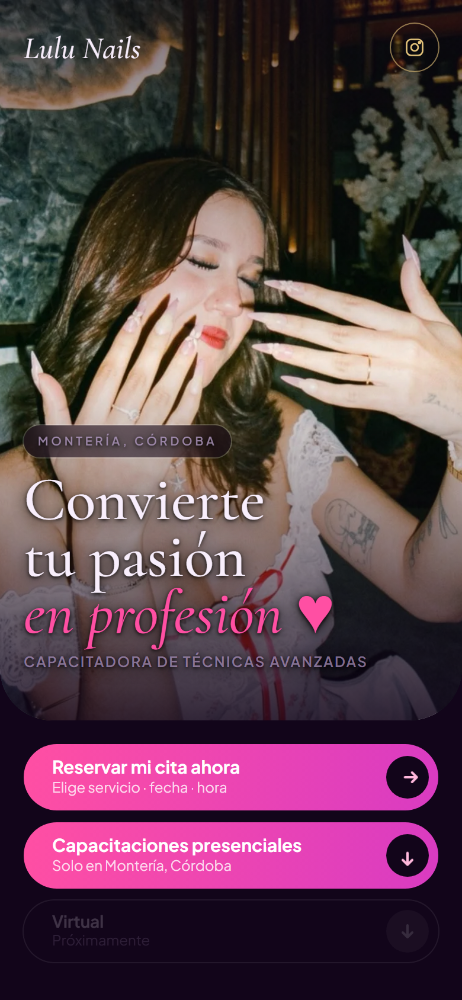
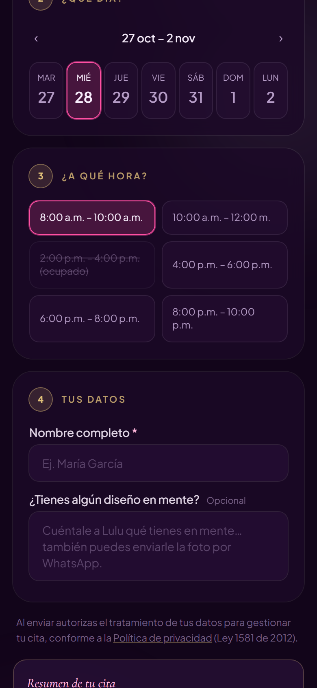
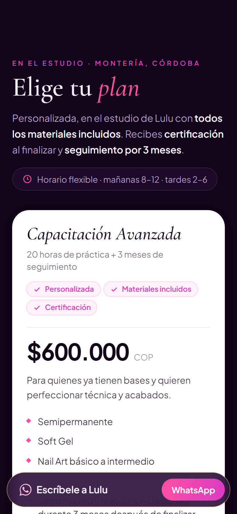
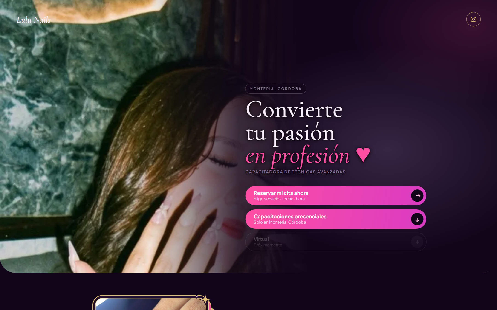
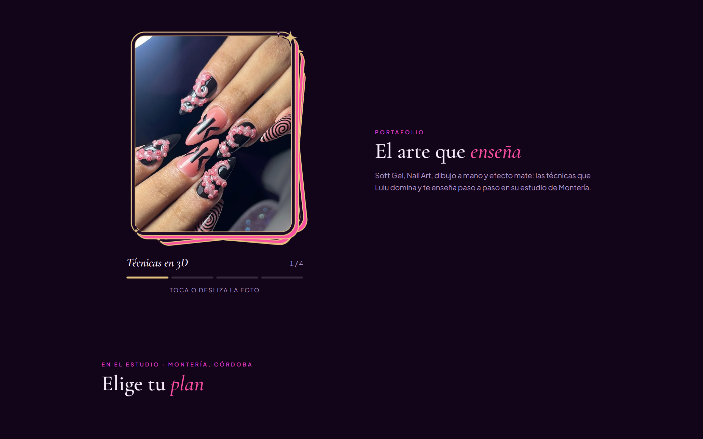

# Lulu Nails · Landing + agenda virtual

> **Caso de estudio** de un proyecto real en producción para una manicurista y capacitadora de Montería, Córdoba (Colombia).
> 🔗 **En vivo:** [www.lulunails.co](https://www.lulunails.co)
>
> El código fuente es **privado** (proyecto de cliente). Este repositorio solo documenta el resultado y las decisiones técnicas.

  
  
  

## El problema

Lulu atendía a sus clientas y vendía sus capacitaciones desde Instagram y WhatsApp. Cada cita implicaba una conversación larga ("¿qué día tienes?", "¿a qué hora?"), con respuestas tardías y citas que se perdían. Necesitaba:

1. Una **página de aterrizaje** para los anuncios pagados de Instagram, que explique sus capacitaciones y cierre en WhatsApp.
2. Una **agenda virtual** donde la clienta vea horarios libres y reserve sola, sin pagos en línea.
3. Un **panel privado** para confirmar citas y bloquear días u horas, con aviso al celular de cada reserva nueva.

## Qué incluye

| | |
|---|---|
| **Landing mobile-first** | Estética "lujo / glam" propia, hero con foto, portafolio en mazo de cartas interactivo, planes, preguntas frecuentes y botón fijo de WhatsApp. |
| **Agenda virtual** | Elección de servicio, día y hora en 4 pasos; solo se muestran los horarios que aún están libres, de lunes a domingo. El mensaje de la reserva se abre ya escrito en WhatsApp. |
| **Anticipo sin pagos en línea** | Una cita **aparta el horario 24 h** mientras la clienta paga el anticipo por WhatsApp; si no paga, el horario se libera solo. |
| **Panel privado** | Calendario de 7 días, confirmar o cancelar citas, bloquear horas o días completos. |
| **Avisos al celular** | Notificación push en el iPhone de la dueña por cada reserva nueva. |
| **Medición de anuncios** | Meta Pixel con **consentimiento de cookies** y evento de contacto al tocar WhatsApp. |
| **Cumplimiento legal** | Política de privacidad (Ley 1581 de 2012), identificación del comerciante y canal de PQR. |

## Decisiones técnicas destacadas

- **Sitio estático + funciones sin servidor.** Astro 5 y Tailwind CSS 4 para páginas casi sin JavaScript (carga rápida en celular); la lógica de reservas corre en funciones de Vercel.
- **Cero reservas dobles, garantizado por la base de datos.** La regla "una sola cita activa por fecha y hora" vive en un índice único de Postgres, no solo en el código. En una prueba con **100 solicitudes simultáneas por el mismo horario, solo una se aceptó** y las otras 99 recibieron "horario ocupado".
- **Migración de Google Sheets a Postgres.** La primera versión guardaba las citas en una hoja de cálculo, que tardaba segundos por reserva y no podía impedir reservas simultáneas. Se migró a Postgres (Neon) con un driver HTTP, sin conexiones persistentes.
- **Zona horaria explícita.** Colombia es UTC−5 sin horario de verano; todas las comparaciones de "ya pasó" se calculan con ese desfase, para que la agenda no cambie de día a las 7 p. m.
- **Límite por persona.** Un máximo de solicitudes pendientes por origen (con huella irreversible, no la dirección IP) evita que alguien aparte toda la semana.
- **Avisos que nunca rompen una reserva.** La notificación push se envía solo después de guardar la cita, con tiempo límite; si falla, la clienta ni lo nota.
- **Seguridad.** Todo texto escrito por clientas se escapa antes de mostrarse en el panel; validación de fechas y servicios en el servidor; cabeceras de seguridad HTTP; secretos solo en variables de entorno.
- **Pruebas.** Unitarias de fechas y huso horario, más pruebas de concurrencia contra la base de datos real con datos de ejemplo.

## Stack

`Astro 5` · `Tailwind CSS 4` · `JavaScript / Node 24` · `Vercel (hosting y funciones)` · `Postgres en Neon` · `Web Push (VAPID)` · `Meta Pixel` · `Playwright (pruebas y capturas)`

## Capturas

  

  

## Equipo

Diseño y desarrollo por **[MSN Solutions](https://msn-solutions-web.vercel.app/)**, un grupo de jóvenes que asesora marcas para impulsar su crecimiento y hacer más fluidos sus procesos.

---
© MSN Solutions. Todos los derechos reservados. Las imágenes y la marca pertenecen a Lulu Nails.
